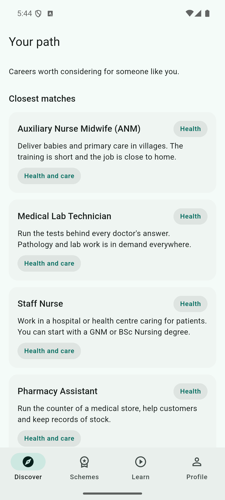
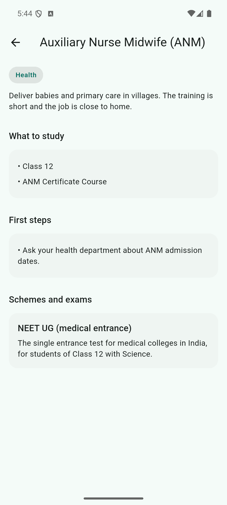
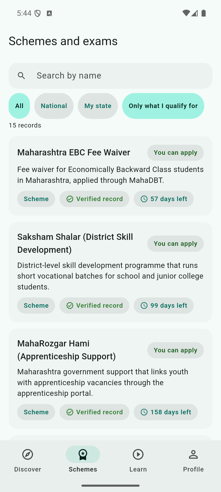
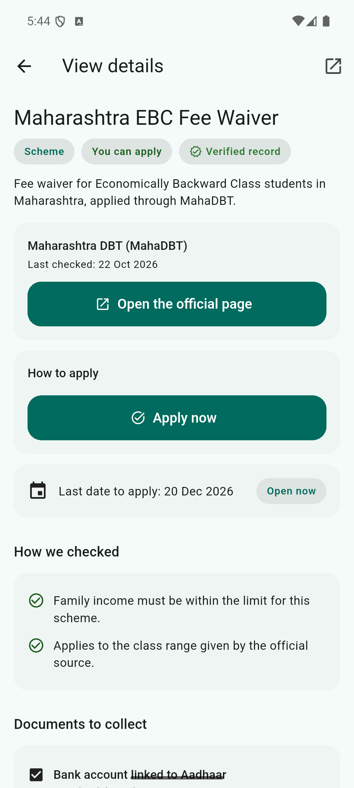
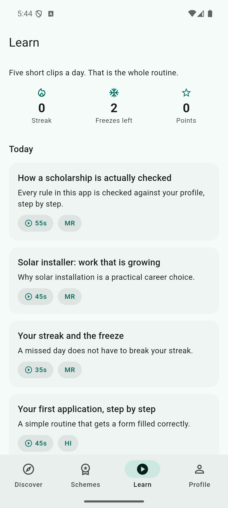
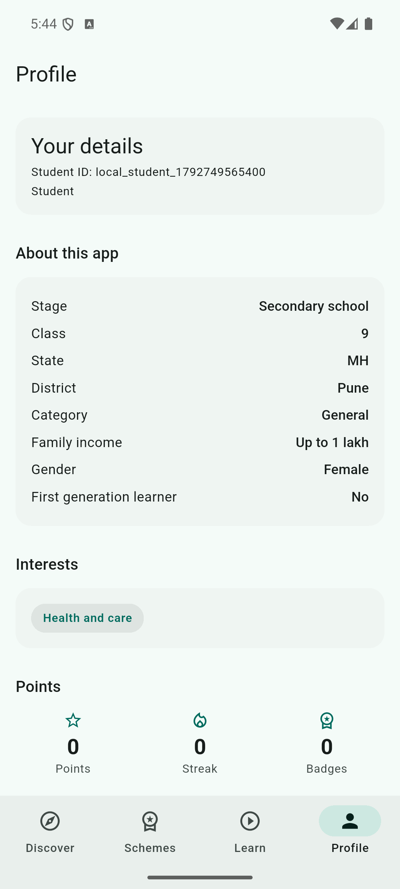
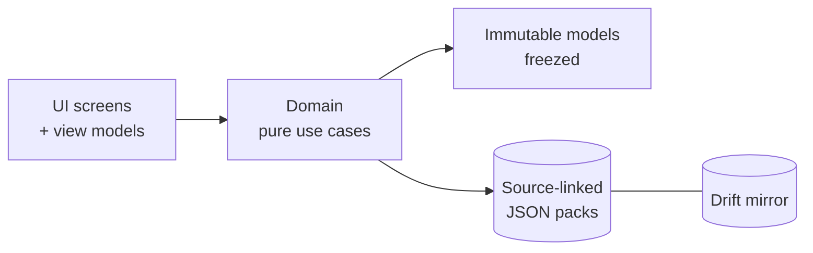

<div align="center">

# 🧭 Margadarshak

### Your next step, in your own language

**Career guidance for rural Indian students that never invents a scheme.**


</div>

---

> 💡 **The promise behind every screen**
> The AI explains and personalises, but **eligibility is decided by rules against a source-linked list**.
> Every scholarship, scheme, exam and apprenticeship in the app carries an **official source link** and a
> **last-verified date**. If nothing matches, Margadarshak says so instead of guessing — it can never
> invent a scheme.

## 📱 What it does

| | |
|---|---|
| 🎯 **Discover** | Careers worth considering, ranked by the student's own interests - shown in Marathi or Hindi first |
| 💸 **Schemes & exams** | What they actually qualify for, with **Apply now** links, deadlines and the documents to collect |
| 📚 **Learn** | Short daily voice clips and a one-question check-in that keeps the streak alive |
| 👩‍🏫 **Facilitator mode** | Teachers and mentors run classes, share modules and follow the roster |
| 🌐 **Three languages** | English, मराठी and हिन्दी as first-class citizens, not translations after the fact |
| 📴 **Offline first** | The entire verified catalogue ships inside the app - it works with no network at all |

## 🖼️ Screenshots

| Discover - closest matches | Career detail | Schemes & exams |
|:---:|:---:|:---:|
|  |  |  |

| Scheme detail - verified | Learn - daily clips | Profile |
|:---:|:---:|:---:|
|  |  |  |

## 🧱 Tech stack

| What | We chose |
|---|---|
| 🖌️ App framework | Flutter (Material 3) |
| 🔤 Language | Dart |
| 🧠 Screens & state | provider + MVVM view models |
| 🧭 Navigation | go_router (4-tab shell) |
| 💾 Offline database | Drift (SQLite) - the local source of truth |
| 📦 Verified content | Versioned JSON data packs inside the app |
| ❄️ Data models | freezed + json_serializable |
| 🔊 Voice out | flutter_tts |
| 🎤 Voice in | speech_to_text |
| ☁️ Cloud (optional) | Firebase Auth + Firestore behind the same interfaces |
| 🌍 Languages | ARB + intl (English / Marathi / Hindi) |
| ✅ Quality | flutter_test suite + flutter analyze always clean |

## 🏗️ How it is built



Details live in [docs/RELEASE_CHECKLIST.md](docs/RELEASE_CHECKLIST.md).

## 🚀 Run it

```bash
git clone https://github.com/Meet6338-X/Margadarshak
cd Margadarshak/margadarshak
flutter pub get
dart run build_runner build --delete-conflicting-outputs
flutter run
```

## 🗺️ Roadmap

- [x] Eligibility rules engine (no AI decisions on money)
- [x] Apply-now links verified against the live portals
- [x] Deadline alerts with ICU plurals
- [ ] Voice input adapter powered by Bhashini ASR
- [ ] Network repository syncing the Drift mirror from a REST pack source
- [ ] More states: `assets/data/states/<code>/schemes.json` works with zero code changes
- [ ] Play Store publication (signed AAB already builds)

## 🤝 Contributing

This repository was built in public through **27 reviewed pull requests** which you can browse from the
**Pull requests** tab - every feature has its own PR with a full explanation. Small, focused PRs are
the house style: one feature, one PR, tests and `flutter analyze` green. PRs welcome!

---

<div align="center">
Made with 💚 for the students of rural Bharat
</div>
